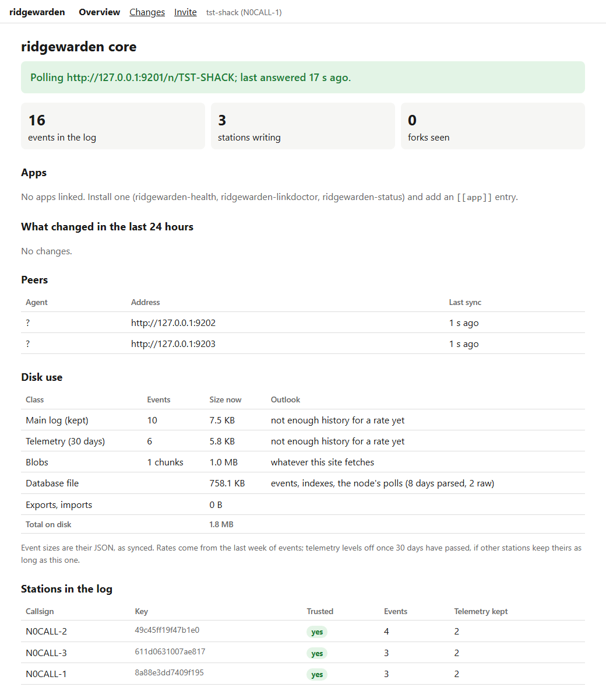
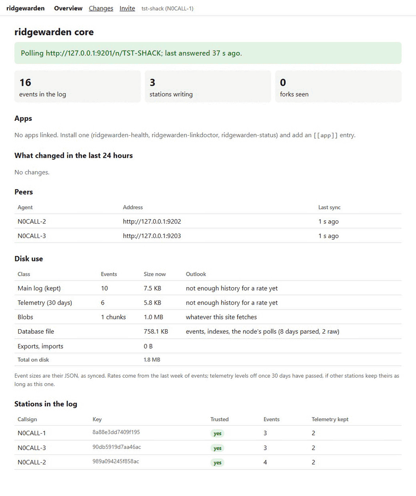
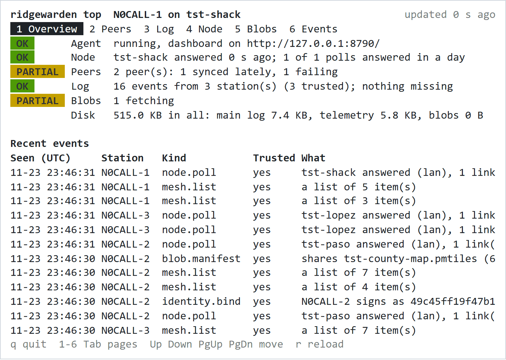
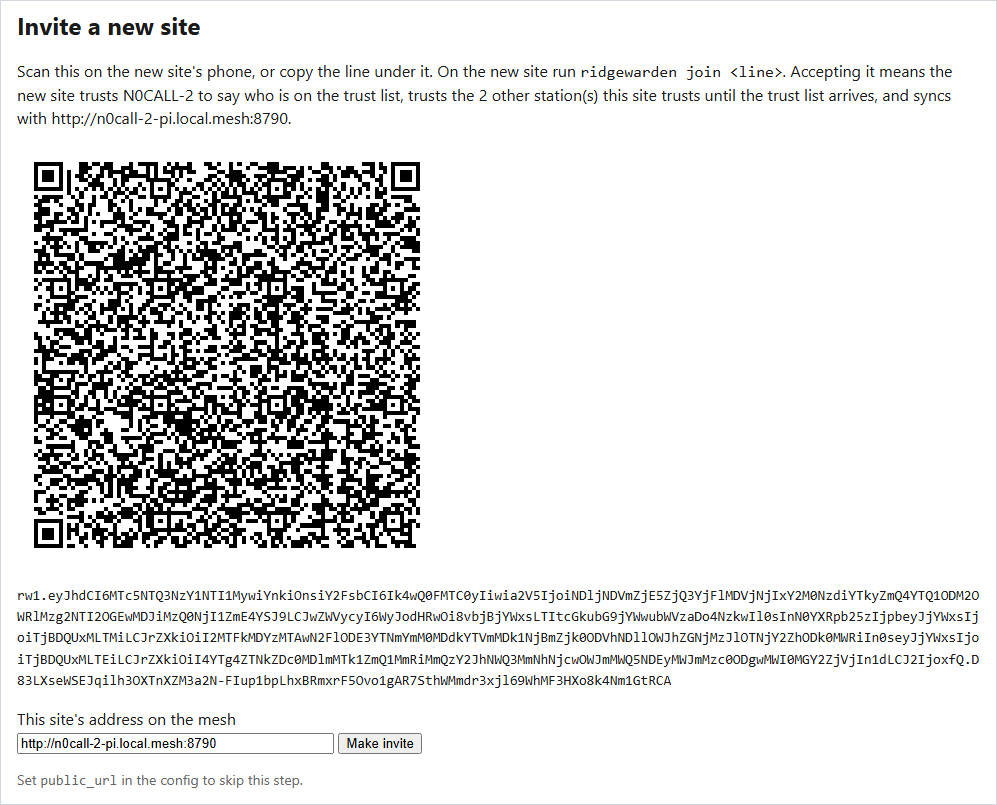

# ridgewarden

**The shared agent behind a suite of AREDN mesh apps: polls the node once, keeps a signed log every site agrees on, and keeps working when the mesh splits.**

[](https://github.com/Londopy/ridgewarden/actions/workflows/ci.yml)
[](https://github.com/Londopy/ridgewarden/releases/latest)
[](https://github.com/Londopy/ridgewarden/releases/latest)
[](https://github.com/Londopy/ridgewarden/releases)
[](CHANGELOG.md)
[](LICENSE)

[](https://github.com/Londopy/ridgewarden/commits/main)
[](https://github.com/Londopy/ridgewarden/graphs/commit-activity)
[](https://github.com/Londopy/ridgewarden/issues)
[](https://www.rust-lang.org)
[](#install)
[](https://github.com/Londopy/ridgewarden/pkgs/container/ridgewarden)

<picture>
  <source media="(prefers-color-scheme: dark)" srcset="docs/images/dashboard-dark.png">
  
</picture>

<sub>The dashboard at one of three sites on a simulated mesh (ridgewarden-sim), with all three in sync. The station names are made up.</sub>

ridgewarden is a small agent that runs on a Raspberry Pi (or any Linux box) on an AREDN node's LAN. It reads the node's API (never writes to it), keeps a signed append-only event log that merges cleanly after the mesh splits and heals, syncs that log with the agents at other sites, and serves a small dashboard. The apps are separate programs in their own repos; each one runs next to a core and builds its pages from the core's event feed.

## The apps

| App | Repo | What it does |
|---|---|---|
| Mountaintop SDR network (01) | [ridgewarden-sdr](https://github.com/Londopy/ridgewarden-sdr) | A signed directory of every receiver on the mesh, amateur-band-only profiles over RF, and finding who hears a signal loudest |
| Services that survive site loss (02) | [ridgewarden-failover](https://github.com/Londopy/ridgewarden-failover) | A MeshChat-compatible chat backend on the signed log: keeps working when a site goes down, merges when it returns |
| Planner (03) | [ridgewarden-planner](https://github.com/Londopy/ridgewarden-planner) | Failure what-ifs on the live mesh, terrain and ITM predictions calibrated against real links, candidate sites ranked by redundancy |
| Offline library (04) | [ridgewarden-library](https://github.com/Londopy/ridgewarden-library) | Offline Wikipedia, maps and weather alerts on the mesh, mirrored between sites and checked against the publishers' hashes |
| Topology game (05) | [ridgewarden-game](https://github.com/Londopy/ridgewarden-game) | Capture the Site: teams hold chains of real links, scored only while the links are up |
| Service health (06) | [ridgewarden-health](https://github.com/Londopy/ridgewarden-health) | Probes every advertised service from every site; tells link problems from service problems |
| Link Doctor (07) | [ridgewarden-linkdoctor](https://github.com/Londopy/ridgewarden-linkdoctor) | Link history, drift, one-way and noise alarms, single points of failure, a scored next-workday list |
| Status page (08) | [ridgewarden-status](https://github.com/Londopy/ridgewarden-status) | Green, yellow or red for served agencies, in plain words, with incidents, maintenance and a wall display |
| Weather sensor (09, experimental) | [ridgewarden-weather](https://github.com/Londopy/ridgewarden-weather) | Wet-antenna and ducting signals in link data, joined with rain and soundings, exported as an open dataset |
| Passive radar (10, experimental) | [ridgewarden-radar](https://github.com/Londopy/ridgewarden-radar) | Passive radar detections from blah2 over the mesh, tracked across sites and checked against ADS-B |
| Lightning (11) | [ridgewarden-lightning](https://github.com/Londopy/ridgewarden-lightning) | Locates lightning from receivers at several sites with the internet down, with dry-lightning fire alerts |
| Data mules (12) | [ridgewarden-mule](https://github.com/Londopy/ridgewarden-mule) | Plans what couriers carry between mesh islands and tracks signed delivery receipts |
| Lamplighters (13) | ridgewarden-lamplighters (not public yet) | A slow, always-on game on the real mesh: players keep each site's lantern lit by sending caravans along the live links |

## Quick start

On a 64-bit Raspberry Pi OS or x86_64 Linux box on an AREDN node's LAN:

```sh
curl -fsSL https://github.com/Londopy/ridgewarden/releases/latest/download/install.sh | sudo RIDGEWARDEN_CALLSIGN=N0CALL sh
```

The agent runs as a systemd service, and the dashboard is on `http://<pi>:8790/`. Bring the other sites in with an [invite](#joining-other-sites).

💡 To watch it live from an SSH session:

```sh
sudo -u ridgewarden ridgewarden top
```

## What the dashboard shows

The headline says how polling the node is going:

| | Headline | When |
|:-:|---|---|
| 🟢 | Polling *node*; last answered 2 min ago. | The node answered the last poll, within three poll intervals. |
| 🔴 | Node *node* did not answer at *time*. | The last poll failed. |
| 🔴 | Node *node* last answered at *time*. | Its last answer is more than three poll intervals old. |
| ⚪ | No poll yet. | The agent hasn't polled its node yet. |



<sub>A partition drill on the simulator: site 2 (tst-paso) cut off for 30 seconds and healed, about two minutes sped up to 12 seconds. The station names are made up.</sub>

Under the headline: how many events the log holds, how many stations write to it and how many forks it has seen; links to the apps in the config; what changed on the mesh in the last 24 hours, as seen from this node; each peer and how its last sync went; disk use per class; and each station in the log, with its key, whether this site trusts it, its events (and how many are still missing) and the telemetry kept. A peer from the config or an invite shows `?` for its callsign, since only a peer found from its advert has its signed identity checked.

The Changes page makes the same comparison over 1 hour, 24 hours or 7 days, and the invite page is under [joining other sites](#joining-other-sites). A site that trusts only itself gets a note on how to join the others. The overview and the Changes page reload every minute.

## In a terminal

<picture>
  <source media="(prefers-color-scheme: dark)" srcset="docs/images/top-dark.png">
  
</picture>

<sub>`ridgewarden top` at 80x24 during the drill above, with site 2 cut off, on the simulator. The test suite draws it from what site 1's core and node answered then (`tests/fixtures/top-drill.json`). The station names are made up.</sub>

`ridgewarden top` is for a terminal or an SSH session: an overview, then a page each for peers, the log (each station's chains, forks, gaps and refused events), the node and the nodes it crawls, blobs with fetch progress, and recent events. It reads again every 2 s (`--every <seconds>`) and keeps showing the last good read, marked, if one fails.

| Keys | Do |
|---|---|
| `1` to `6`, Tab, Shift-Tab, Left, Right | Switch pages |
| Up, Down, PgUp, PgDn, Home, End (or `j`, `k`, `g`, `G`) | Move through a list; the Events page shows the picked event's details under it |
| `r` | Read again now |
| `q`, Ctrl-C | Quit |

| | Pill | Means |
|:-:|---|---|
| 🟢 | OK | Working: heard from within three of its intervals, nothing missing, or a blob that's here |
| 🟡 | PARTIAL | Working, with something missing or under way: a station with gaps or forks, a blob being fetched, or a group whose members disagree |
| 🔴 | DOWN | The last try failed, the station's key is revoked, or a blob can't go on |
| ⚪ | STALE | The last success is more than three intervals old |

Run it as the agent's user, `sudo -u ridgewarden ridgewarden top`, so it can read the agent's database. It won't run as root where the agent doesn't, since files root opens in the data dir could lock the agent out. `NO_COLOR=1` turns colors off.

## Features

- **One poller per site.** Only the core talks to the AREDN node, at most once a minute (default every 5). The apps never touch it. 4.x nodes answer at `/a/sysinfo` and 3.x nodes at `/cgi-bin/sysinfo.json`; the core finds which, and reads each reply by the `api_version` it reports, since the two firmware lines use some field names differently.
- **What changed (spec 00 M0).** Nodes, services, links and firmware, today against yesterday.
- **Signed, partition-tolerant log (spec 00 M1).** Every observation is an Ed25519-signed, hash-chained event in plain JSON (Part 97: sign, never encrypt). Agents pull from each other over plain HTTP. After a partition heals, both sides hold exactly the same events, including both branches when one key ended up on two boxes. CI runs 20 seeded drills of random partitions, flaky links, cloned keys and pruning, and checks that every site ends up identical with nothing lost. Those partitions are simulated, with agents on one machine; no real mesh has been split under it yet.
- **Survives crashes and power cuts.** Each event is on disk before anyone sees it. Tests kill a writer mid-append, and simulate a power cut by cutting the tail off the database's write-ahead log; either way the log reopens whole and carries on numbering where it left off.
- **Trust you choose.** Every correctly signed event is stored and relayed, but apps only believe events from this station and the stations on the signed trust list. `ridgewarden revoke` stops anyone believing a station's later events; someone holding a stolen key can still write events that claim to be older, so also take the station off the trust list.
- **Bounded.** A peer can't make an agent download unbounded data, stall its poller, or push its clock far ahead: pulls, pages, authors and clock jumps are all capped.
- **Disk use that levels off, and shows it.** Polls and probes live in a separate telemetry log per station. A signed checkpoint lets every site prune it after 30 days (configurable); identity, trust, lists and app data are kept. The dashboard and `ridgewarden status` show the size of the main log, telemetry, blobs and other files, how fast the main log grows, and where telemetry levels off at the current rate.
- **Joining with a QR code.** `ridgewarden invite` prints the invite line and its QR code; the dashboard's invite page shows both to someone on the machine itself.
- **Files over the mesh.** Offline maps, reference content and updates move as 1 MiB chunks, each checked against its hash, resumable and rate-limited (overall, and per peer for slow links), fetched only where wanted, from the peers an app prefers first.
- **Updates without the internet.** `ridgewarden update` installs signed releases from GitHub, or from the mesh when a site has no internet, and only after you confirm. It works in a new folder in /var/tmp that only root can open, never in the data dir or $TMPDIR, so the agent's own user can't swap a release between the check and the install.
- **Optional crawl.** One hub agent can also poll the other backbone nodes (with their owners' OK), so links between sites without an agent show up too.
- **Optional metrics.** `GET /local/v1/metrics` gives the numbers from `ridgewarden status` in Prometheus' text format, for a scraper on the same machine (off by default).

## How it works

| Part | How |
|---|---|
| **Events** | Each event's `id` is the BLAKE3 hash of its canonical JSON body, and `sig` is an Ed25519 signature over that hash (strict verification; keys and callsigns must be in canonical form). Each author's events are numbered and chain through `prev`; a Lamport clock gives every agent the same order even when wall clocks disagree. From this version on, `mono_time` counts on from where the database left off, across restarts, so a station's new events never go back in it (0.1.0 started it again from 0 on each start). |
| **Merge** | The log is a set of events keyed by id, so merging is a union. Heads carry, per author, the gap-free chain length, fork points, and an XOR digest of every id held. When digests differ, agents compare digests per range of sequence numbers and fetch only the ranges that differ. |
| **Policy on read** | Trust and revocation are applied when the feed is read, never by refusing to store, so what an agent holds never depends on arrival order. |
| **Storage** | SQLite in WAL mode with full fsync, so a power cut can't make an agent reuse sequence numbers its peers already hold. Beside the log, the core keeps each poll of its own node in tables of its own: parsed (links, firmware, the service and host lists) for 8 days, for "what changed" and `top`, and the raw reply for 2 days, to check what the node actually sent. Those tables stay on the machine; other sites get the poll as its `node.poll` event. |

## Install

The [quick start](#quick-start) script is the usual way in. It picks the right build, checks it against `SHA256SUMS.txt`, and checks the release signature with the key inside the binary it just downloaded, which shows the files belong together but not who made them. It then installs `/usr/local/bin/ridgewarden` and a systemd service, and with `RIDGEWARDEN_CALLSIGN` set it writes the config and starts the service. Once it's installed, `ridgewarden update` checks every later release against the key the install already has.

To install the core and the apps in one go, name the apps you want (or none for the ten main ones, or `all` to add the two experimental ones):

```sh
curl -fsSL https://github.com/Londopy/ridgewarden/releases/latest/download/install-all.sh | sudo RIDGEWARDEN_CALLSIGN=N0CALL sh -s -- health linkdoctor status
```

Before each app's installer runs, its release's checksums are checked with the core's release key, and the installer against those checksums. On a box with no core yet, the core comes from its own installer over HTTPS first, so those checks then show the apps came from the same release key as that core.

Every [release](https://github.com/Londopy/ridgewarden/releases/latest) has:

| Download | What it is |
|---|---|
| `install.sh` | The script from the quick start |
| `install-all.sh` | The core plus the apps you name, each checked with the core |
| `ridgewarden_<version>_arm64.deb` / `_amd64.deb` | Debian / Raspberry Pi OS package with the systemd service |
| `ridgewarden-v<version>-<arch>-linux.tar.gz` | Static binary, service file, README and license |
| `ghcr.io/londopy/ridgewarden:<version>` (and `:latest`) | Docker image (set `data_dir = "/data"`, mount `/data` and `/config`, and use `--network host` so apps on the same box can reach the local API) |
| `<file>.torrent` and magnet QR codes | Each `.deb` and `.tar.gz` as a torrent, with its GitHub download as the web seed (the scripts, checksums and signature are a few KB and have none) |
| `SHA256SUMS.txt` and `SHA256SUMS.txt.sig` | Checksums, signed with the release key |

Check a download with `sha256sum -c SHA256SUMS.txt --ignore-missing`. If you already have ridgewarden installed, `ridgewarden verify-release SHA256SUMS.txt` checks the release signature with the key your install already trusts. The binaries are not code-signed in the Windows sense.

<details>
<summary><b>Installing the .deb by hand</b></summary>

The `.deb`'s own install scripts don't check the release signature; only `install.sh` does. For a `.deb` you fetched yourself, put `SHA256SUMS.txt` and its `.sig` next to it and run the two checks above first. The package makes the `ridgewarden` user and the folders but no config, so set it up after installing:

```sh
sudo apt install ./ridgewarden_<version>_arm64.deb   # _amd64 on a PC
sudo ridgewarden --config /etc/ridgewarden/ridgewarden.toml init --callsign N0CALL --data-dir /var/lib/ridgewarden
sudo chown -R ridgewarden:ridgewarden /var/lib/ridgewarden
sudo systemctl enable --now ridgewarden
```

</details>

In the Docker image the agent runs as root, so its app token is root's: run the apps in the same container setup or use the packages, which give each app its own user in the `ridgewarden` group. The image has nothing but the binary, so `ridgewarden update` can't run in it (no curl or tar): pull the new image instead.

The service runs as its own user, `ridgewarden`, which owns the data dir, `/var/lib/ridgewarden`. Run the commands that open the agent's data (all but `init`, `update` and the release commands) as that user, so they can open the database and the files they write keep the right owner:

```sh
sudo -u ridgewarden ridgewarden <command>
```

`ridgewarden update` replaces the binary, so it runs as root: `sudo ridgewarden update`.

## Usage

### Joining other sites

Bring a new site in with one line from any site already in:

```sh
# on a site already in: prints the line and, in a terminal, its QR code
sudo -u ridgewarden ridgewarden invite --url http://n0call-pi.local.mesh:8790
# on the new site
sudo -u ridgewarden ridgewarden join rw1.eyJh...
sudo systemctl restart ridgewarden
```

The line is `rw1.`, the signed invite as canonical JSON in base64url, and its signature: no quotes or braces, so it pastes into a shell or a chat message as it is. `ridgewarden join` shows who it is from and what accepting it means before it trusts anyone.

<picture>
  <source media="(prefers-color-scheme: dark)" srcset="docs/images/invite-dark.png">
  
</picture>

<sub>The dashboard's invite page on the simulator. The station names and the address are made up.</sub>

The QR code is drawn black on white whatever the terminal's colors. Invites carry every trusted station's key, so the codes are big: about 100 columns wide for two stations and 165 for a dozen. Widen the terminal or use the dashboard's invite page (`/invite`). Past about 20 stations the line no longer fits in a QR code at all and has to be pasted. That page only answers on the machine itself, since an invite is signed with the station's key: open it on the Pi, or tunnel to it with `ssh -L 8790:127.0.0.1:8790 pi@<pi>` and browse `http://127.0.0.1:8790/invite`. Set `public_url` in the config so neither needs `--url`.

Joining trusts the inviting station and everyone it trusts. The trust list is a signed event any station on it can update:

```sh
sudo -u ridgewarden ridgewarden trust list                 # who this site trusts, and why
sudo -u ridgewarden ridgewarden trust add <key> --call N0NEW
sudo -u ridgewarden ridgewarden trust remove <key>
```

### Other commands

Each runs as `sudo -u ridgewarden ridgewarden <command>`, except `update` (`sudo ridgewarden update`). A file you add or export goes through that user too, so it has to be somewhere the `ridgewarden` user can read or write.

| Command | What it does |
|---|---|
| `status` | Agent running? Node answering? Peers, disk use per class |
| `top` | The same and more, live in the terminal (see [above](#in-a-terminal)) |
| `diff --hours 24` | What changed on the mesh, as seen from this node |
| `whoami` | This station's callsign and public key |
| `revoke --reason <why>` | Tell every site to stop believing anything this station writes from now on, e.g. after its SD card was stolen |
| `blob add map.pmtiles` | Share a file over the mesh (`--priority 0-9`, 0 fetches first) |
| `blob list` | The blobs this site knows about |
| `blob want <id>` | Fetch one another site shared |
| `blob want <id> --from http://10.1.2.3:8790` | Ask that site first (`--only` asks no one else) |
| `blob export <id> out.pmtiles` | Write a complete blob out to a file |
| `blob unwant <id>` | Stop fetching or keeping it and free its chunks |
| `update` | Check for a signed release and install it if you say yes (`--check` only reports, `--publish` also republishes it on the mesh for sites without internet) |

What `diff` prints:

```
$ sudo -u ridgewarden ridgewarden diff
tst-shack: 2026-11-19 07:46 UTC compared with 2026-11-18 07:45 UTC
  New nodes on the mesh: tst-hilltop
  Gone services: Old Camera (tst-north)
  Firmware on tst-shack changed: 3.25.8.0 to 4.26.7.0
```

The dashboard is on `http://<pi>:8790/`. To let other sites find this one without an invite, advertise a service named `ridgewarden` on your node pointing at that URL. The agent can't do this for you: an advert is a setting on the node, and the agent never writes to the node. Other agents check an advert's signed identity before they sync with it.

### Metrics

With `[metrics] enabled = true`, `GET /local/v1/metrics` answers in Prometheus' text format: events and bytes per log, disk use, chains, forks, trusted stations, whether the node answered and when, its links and services, each peer's last pull, and blobs. Like the rest of the local API it only answers on loopback and wants `local.token` as a bearer token, so run the scraper on the Pi and treat it like an app: that token can also sign events. Each scrape counts the log the way the dashboard does, so once a minute is plenty.

## Configuration

`/etc/ridgewarden/ridgewarden.toml` (`ridgewarden init` writes a commented one):

```toml
callsign = "N0CALL"              # every event is signed under this
data_dir = "/var/lib/ridgewarden"
listen = "0.0.0.0:8790"

[node]
url = "http://localnode.local.mesh"
poll_interval_s = 300            # 60 minimum; agree it with the node's owner

[sync]
peers = ["http://10.1.2.3:8790"] # optional; adverts are found automatically

[trust]
keys = []                        # extra stations to trust; invites usually cover this
blocked = []                     # stations whose events this site won't store at all

[retention]
telemetry_days = 30              # your polls and probes are pruned everywhere after this

[blobs]
rate_kbps = 2000                 # bulk files never move faster than this
window = "1-6"                   # only fetch between these UTC hours ("" = any time)
auto_want = ["ridgewarden-release/"]   # fetch releases automatically, for offline updates

[blobs.peer_rate_kbps]           # optional: a lower cap for chunks from a peer on a slow link
"http://10.1.2.3:8790" = 500     # the address as `ridgewarden status` lists the peer

[crawl]                          # also poll other nodes for their links (off by default)
enabled = false
nodes = ["n0call-cuesta", "n0call-blackmtn"]

[metrics]
enabled = false                  # GET /local/v1/metrics for a Prometheus scraper on the Pi

[[app]]                          # linked from the dashboard
name = "Status page"
url = "http://10.1.2.3:8793/"
```

<details>
<summary><b>The other settings</b>, with their defaults</summary>

| Setting | Default | What it does |
|---|---|---|
| `public_url` | none | How other sites reach this core over the mesh, e.g. `http://n0call-pi.local.mesh:8790`; put into the invites it hands out |
| `node.timeout_s` | 20 | How long a poll waits for the node |
| `sync.interval_s` | 120 | Seconds between sync rounds (5 minimum) |
| `sync.fanout` | 2 | How many peers to pull from each round |
| `sync.discover` | true | Find peers from services named `ridgewarden...` in the node's service list |
| `sync.telemetry` | true | Pull other stations' polls and probes; a data-mule car sets this false to carry less |
| `crawl.interval_s` | 900 | Seconds between crawls (60 minimum) |
| `crawl.url_template` | `http://{node}.local.mesh` | Where a crawled node answers; `{node}` is its name |
| `crawl.follow_links` | false | Also crawl any node a crawled node reports as a neighbor |
| `crawl.max_nodes` | 50 | Most nodes crawled per round when following links |

</details>

## For app authors

Apps use the `ridgewarden-client` crate in this repo. Every `/local/` route answers only on loopback, with the token from `<data_dir>/local.token`. The token is readable by the `ridgewarden` group; each app's package makes its own user in that group, so an app can sign through the core but never read the station key, which stays owner-only.

| Route | In the client | What it does |
|---|---|---|
| `GET /v1/feed?after=<n>` | `CoreClient::feed`, `follow()`, `Projection` | Every event the core holds, in arrival order, each flagged `trusted` and stamped with when the core received it; `follow()` turns it into your own SQLite views |
| `GET /v1/whoami` | `CoreClient::whoami` | The core's callsign, key and node (empty until the core has polled its node) |
| `POST /local/v1/append` | `CoreClient::append`, `append_telemetry` | Have the core sign and log an event |
| `POST /local/v1/blob/add` | `CoreClient::blob_add` | Publish a file the app has put in `<data_dir>/imports`, with a name and a priority. Only that folder, so an app can't publish the station's key. |
| `POST /local/v1/blob/want` | `CoreClient::blob_want`, `blob_want_from`, `blob_want_only_from` | Fetch a blob from other sites, from the peers you prefer first |
| `POST /local/v1/blob/export` | `CoreClient::blob_export` | Write a finished blob to `<data_dir>/exports` |
| `POST /local/v1/blob/unwant` `{root}` | `CoreClient::blob_unwant` | Stop fetching or keeping a blob |
| `GET /v1/blobs?root=<id>` | `CoreClient::blob_status` | One blob's state |
| `GET /v1/peers` | | The peers this core pulls from and how the last pull went |

<details>
<summary><b>Blob routes in detail</b>: preferred peers, unwanting, status</summary>

- **want.** `want` takes an optional `peers` list of core base URLs: those are asked for each chunk first, in order, and the core's other peers only for chunks they don't have (404) or after one fails. A peer fails when it can't be reached within 20 s, doesn't send a whole chunk within 5 minutes, answers with an error, or sends data that doesn't match the chunk's hash; it then sits out the rest of that fetch round (rounds run about a minute, a minute apart). With `"only": true` (`blob_want_only_from`) no other peer is asked, so a chunk the listed peers don't have yet waits for a later round: for fan-out where each link should carry a chunk once. A new list replaces the old one, `[]` clears it, leaving `peers` out keeps it, and `unwant` forgets it. At most 16 peers; a bad address is a 400.
- **unwant.** Its chunks are deleted unless another blob the core still wants or holds lists them; the answer says how many bytes were freed. Auto-wanting leaves it alone afterwards; wanting it again undoes that.
- **blobs.** With `root`: the blob's name, size, priority, author, whether it is complete and wanted, and whether a trusted station published it; 404 until its manifest arrives. Without `root`, up to 1000 blobs, complete and wanted ones first.

</details>

`node.poll` payloads say whether the node sent LQM link-quality trackers (`trackers`, 3.22 and later) and how many trackers were left out as stale (`stale_skipped`), so an app can tell a partial link list from a quiet one, and carry the node's `api_version`. `aredn::parse` reads a reply by that version (`NodeObs::api`): OLSR's 0-1 link qualities and services by address from 1.x, LQM-only links and services by name from 2.x, and both where the version is missing or newer than it knows.

The client's `tui` feature is what `ridgewarden top` is built from, for an app's own terminal view: `tui::run` drives a `View`, `Refresh` loads data on a thread of its own so a slow source never freezes the screen, `Fetch` reads JSON from a local API with a timeout, and `Chrome`, `pill_table`, `Notice` and `Theme` draw the title, tabs, state pills and loading, empty and error states the way `top` does (`NO_COLOR` respected).

## Limits

> [!WARNING]
> Not yet run on a real AREDN mesh, Pi or node. Polling is tested against the simulator and against a 3.25.8.0 reply built field for field from that release's `sysinfo.json` source (made-up names and numbers); the partitions in the drills, and the crashes and power cuts in `tests/crash.rs`, are simulated on one machine. The pictures in this README come from the simulator too.

- **Real-mesh measures.** The spec's ten-minute join and 1 GB-per-site measures need a real mesh group to time and measure; `ridgewarden status` shows the numbers to check.
- **Other operators.** Invites and the trust list haven't been tried by operators who aren't the author yet, which the spec asks for.
- **New keys.** A station can't move to a new key and keep its chain: today it revokes the old key (`ridgewarden revoke`), makes a new one and joins again with an invite, and a station on the trust list adds the new key. Station and device keys (spec change 3) are the answer the spec plans, and wait for users to ask, as it says. Sub-logs beyond telemetry (change 2): the same.
- **One release key.** A 2-of-3 threshold of offline root keys over the release keys: releases are signed by one release key for now.
- **No plugins.** Apps plug in as separate programs on the local API and `ridgewarden-client`, never as code loaded into the agent, so a crash or a bad dependency in an app can't take down the process that signs for the station. There is no in-process plugin API (spec 00 M3).

<details>
<summary><b>Smaller limits</b>: reconciliation, bridges, big lists, blob rates, free disk space</summary>

- **Range-based reconciliation** (change 6): left on purpose; for a regional mesh the heads exchange is a few KB, and the spec says why it would save little until main-log and telemetry chains are reconciled separately.
- **Meshtastic, MeshCore and Reticulum bridges:** separate programs that need the radios.
- **A Build-a-Pi menu entry:** lives in Build-a-Pi's repo.
- **Big lists stay local.** A service or host list bigger than one event holds (256 KB as JSON, a couple of thousand services) stays in the core that polled it: its dashboard, `top` and "what changed" use it, but apps read lists from the log, so no app gets it, here or elsewhere.
- **Per-peer blob rates are set by hand.** The core could guess them from the PHY rates in its link polls, but those overstate what a shared RF link carries, so it doesn't.
- **No free-disk-space figure for apps:** the standard library has no portable call for it and the core takes no new crates; apps that need it still run `df`.

</details>

## Building from source

```sh
git clone https://github.com/Londopy/ridgewarden
cd ridgewarden
cargo build --release
cargo test --workspace
```

Static Linux binaries (what CI builds):

```sh
cargo install cross --locked
cross build --release --target aarch64-unknown-linux-musl -p ridgewarden   # Pi
cross build --release --target x86_64-unknown-linux-musl -p ridgewarden
```

### Try it without a mesh

`ridgewarden-sim` serves a fake mesh whose sysinfo is shaped like the firmware's: 4.x nodes answer at `/a/sysinfo` and redirect `/cgi-bin/sysinfo.json` there, and 3.x nodes answer at `/cgi-bin/sysinfo.json` the way 3.25.8.0 does (OLSR link qualities, services by address) and with an HTML page at `/a/sysinfo`. Both keep a dead neighbor's link-quality tracker listed for a day, as the firmware does. It hosts fake services and has control endpoints to break things:

```sh
cargo run -p ridgewarden-sim -- examples/slo-demo.toml
curl -X POST "http://127.0.0.1:9100/_ctl/link?a=TST-NORTH&b=TST-PASO&up=false"
curl -X POST "http://127.0.0.1:9100/_ctl/advertise?node=TST-SHACK&name=Offline%20Map&up=false"
curl -X POST "http://127.0.0.1:9100/_ctl/service?node=TST-SHACK&name=Mesh%20Chat&up=false"
curl -X POST "http://127.0.0.1:9100/_ctl/node?node=TST-CUESTA&up=false"
```

<details>
<summary><b>Layout</b></summary>

```
src/
  main.rs        CLI: init, run, status, top, invite, join, trust, revoke, blob, update, diff, whoami, release tools
  tui.rs         ridgewarden top
  agent.rs       wiring: poll, crawl and sync loops next to the web server
  app.rs         shared state, node poller, crawl, peer discovery
  config.rs      ridgewarden.toml and the commented example init writes
  identity.rs    the station key
  node.rs        this site's node polls, parsed into tables
  log.rs         append, verify, merge, chains, checkpoints, digests, forks, feed
  trust.rs       invites, joining, the signed trust list
  invite.rs      the one-line invite format
  qr.rs          QR codes for invites (ISO/IEC 18004 byte mode, levels M and L)
  usage.rs       disk use per class and where it is heading
  blobs.rs       chunked, verified file transfer
  update.rs      signed releases from GitHub or the mesh
  store.rs       SQLite schema
  sync.rs        pull-only gossip client
  diff.rs        what changed (spec 00 M0)
  metrics.rs     the optional Prometheus metrics
  web.rs         dashboard, sync API, local API for apps
crates/ridgewarden-client/   shared crate for apps: events, sysinfo parser, feed follower,
                            mesh projection, graph analysis, page layout, terminal views
crates/ridgewarden-client/tests/fixtures/   an AREDN 3.25.8.0 sysinfo reply, from its source
crates/ridgewarden-sim/      fake AREDN mesh for tests and demos
packaging/                  systemd unit, install.sh, .deb scripts, Dockerfile
scripts/release_notes.py    builds the release page
scripts/qr_vectors.py       reference fingerprints for the QR tests (needs segno)
tests/partition.rs          forced partitions, forks, every route, local API
tests/drills.rs             20 seeded random partition drills with pruning
tests/crash.rs              a writer killed mid-append, a write-ahead log cut short
tests/poller.rs             polling fake 3.x and 4.x nodes over HTTP
tests/update.rs             updates from a local server and the mesh, and each way one is refused
tests/regressions.rs        the bugs the second code review found, each failing before its fix
tests/fixtures/top-drill.json   what one site held during a partition drill on the simulator
examples/slo-demo.toml      seven-site demo scenario
docs/specs/                 the spec sheets for the core and each app
docs/images/                the pictures in this README
```

</details>

## Contributing

Issues and pull requests are welcome. See [CONTRIBUTING.md](CONTRIBUTING.md), and add a line under `Unreleased` in [CHANGELOG.md](CHANGELOG.md) for anything a user would notice.

## License

GPL-3.0-or-later. See [LICENSE](LICENSE).
